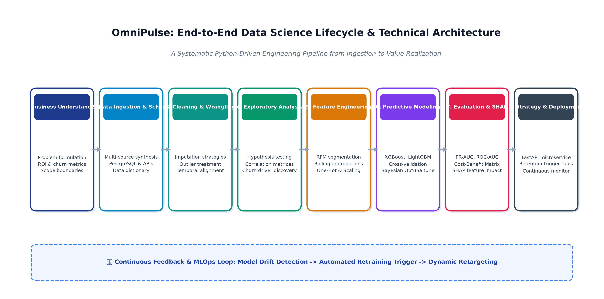
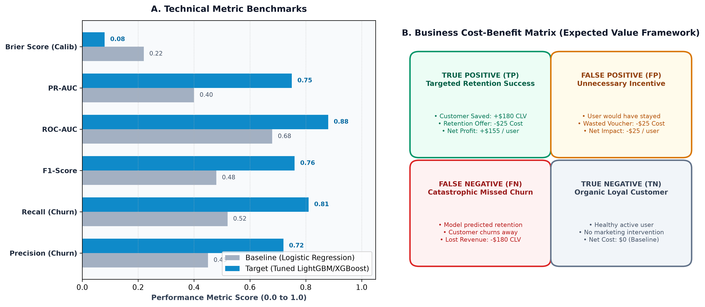
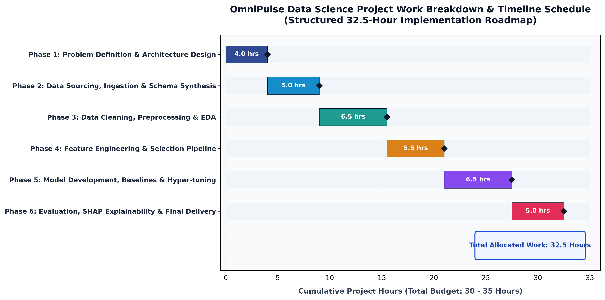
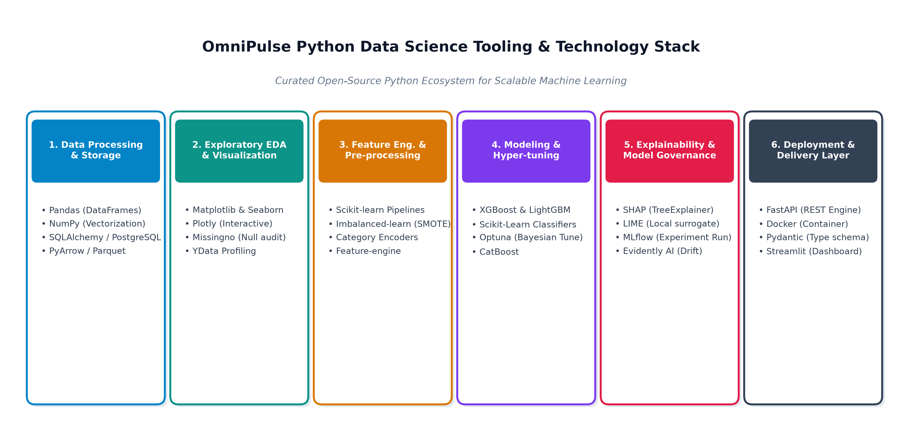

# 📊 Data Science Project Planning & Strategy Design: Project OmniPulse

[](https://www.python.org)
[](https://scikit-learn.org)
[](https://github.com/Laxmi19-creator)
[](./Data_Science_Project_Plan_OmniPulse.docx)
[](https://github.com/Laxmi19-creator)

---

## 📌 Project Overview & Internship Context

* **Intern:** **Laxmi Gupta** (Data Science & Analytics Intern)
* **Assignment Module:** **Week 1 Task: Data Science Project Planning and Strategy Design**
* **Project Codename:** **Project OmniPulse (Subscription E-Commerce & SaaS Churn Architecture)**
* **Primary Objective:** Conceptualize, architect, and plan a comprehensive, end-to-end data science project utilizing Python; design the data sourcing schema, preprocessing protocols, exploratory EDA strategies, feature engineering pipelines, modeling benchmarks, evaluation metrics, timeline allocation (30–35 hours), and business impact models without requiring raw production datasets.
* **Core Deliverables:**
  * 📄 **[Download Word Document (DOCX)](./Data_Science_Project_Plan_OmniPulse.docx)** *(Industrial-grade, executive-styled Microsoft Word project plan with embedded strategic diagrams, comparison tables, and callouts)*
  * 📑 **[Full Technical Strategy Blueprint (Markdown)](./Data_Science_Project_Plan_OmniPulse.md)** *(Comprehensive technical dossier detailing mathematical metrics, relational schemas, Optuna hyper-tuning, and SHAP explainability)*
  * 🖼️ **Strategic Diagrams & Visual Charts (`assets/`):**
    * [Figure 1: End-to-End Data Science Technical Lifecycle Architecture](./assets/ds_methodology_flowchart.png)
    * [Figure 2: 32.5-Hour Project Timeline & Gantt Schedule](./assets/project_timeline_gantt.png)
    * [Figure 3: Model Evaluation Framework & Cost-Benefit Expected Value Matrix](./assets/model_evaluation_framework.png)
    * [Figure 4: Curated Python Data Science & ML Tooling Ecosystem](./assets/python_tech_stack_ecosystem.png)
  * 🐍 **Automation Scripts:**
    * [`generate_diagrams.py`](./generate_diagrams.py) *(Python script utilizing `matplotlib` to render high-resolution 300 DPI vector charts)*
    * [`build_doc.py`](./build_doc.py) *(Python script utilizing `python-docx` to embed diagrams, tables, and generate the final DOCX)*

---

## 🏛️ Executive Summary: The Business Motivation

In modern subscription business models, long-term corporate profitability depends not merely on new customer acquisition, but on **customer retention and lifetime value (LTV) maximization**. 

The subject of this project plan is **OmniPulse**, a digital subscription e-commerce platform with **500,000 active subscribers** generating **$5.0 Million in Monthly Recurring Revenue (MRR)** ($10/month fee, plus add-on marketplace purchases).
* **Current Monthly Churn Rate:** **4.2%** (~21,000 lost subscribers/month).
* **Customer Acquisition Cost (CAC):** **$65.00** per acquired subscriber.
* **Customer Lifetime Value (LTV):** **$180.00** across an average retention span of 18 months.
* **Annualized Revenue Leakage:** **$3.78 Million in lost subscription revenue**, compounded by over **$16.3 Million** in replacement customer acquisition spend.

```
+---------------------------------------------------------------------------------------------------+
|                                  THE FINANCIAL COST OF CHURN                                      |
|                                                                                                   |
|    500,000 Subscribers      4.2% Monthly Churn      $65 CAC / $180 LTV      $3.78M Annual Leakage |
|           [👥]                     [📉]                    [💰]                    [🚨]           |
+---------------------------------------------------------------------------------------------------+
```

**Project OmniPulse** replaces reactive marketing win-back emails with a proactive, Python-driven machine learning engine that flags at-risk subscribers **30 to 45 days prior to cancellation**, uncovering behavioral friction points and driving targeted retention interventions.

---

## 🎯 Project Objectives & Scope Boundaries

### Specific Objectives
* **Predictive Accuracy:** Train gradient-boosted decision trees (XGBoost/LightGBM) achieving **ROC-AUC $\ge$ 0.88** and **PR-AUC $\ge$ 0.72**.
* **Financial Churn Reduction:** Reduce net monthly churn from **4.2% to 3.5%**, preserving **~3,500 subscribers/month ($756,000 in saved annual recurring revenue)**.
* **Risk Stratification:** Classify subscribers into High-Risk (>75%), Medium-Risk (45–75%), and Low-Risk (<45%) tiers for personalized marketing intervention.
* **Explainability:** Generate individual-level **SHAP (SHapley Additive exPlanations)** attribution scores for 100% of high-risk customers.

### Scope Boundaries
```
+---------------------------------------------------+-----------------------------------------------+
|                    IN-SCOPE                       |                  OUT-OF-SCOPE                 |
+---------------------------------------------------+-----------------------------------------------+
| • Multi-source relational data schema design      | • Real-time streaming Kafka/Flink pipelines   |
| • Temporal feature engineering (RFM, slopes)     |   (Batch scoring sufficient for Phase 1).     |
| • Imbalanced data treatment (SMOTE, class-weights)| • Automated credit card processing/rebilling  |
| • Cross-validated model benchmarking (XGB/LGBM)   |   infrastructure modifications.               |
| • Cost-Benefit evaluation via Expected Value      | • Deep learning on unstructured support audio |
| • SHAP global and local explainability models     |   (Text sentiment scores used instead).       |
| • FastAPI REST endpoint contract for batch scoring| • Front-end web application UI redesign.      |
+---------------------------------------------------+-----------------------------------------------+
```

---

## 🔄 End-to-End Methodology & Architecture



1. **Data Ingestion & Schema:** Synthesizing customer demographics (`dim_customers`), transactional billing history (`fct_billing_history`), engagement telemetry (`fct_engagement_telemetry`), and support sentiment (`fct_customer_support`).
2. **Cleaning & Wrangling:** MICE (Multivariate Imputation by Chained Equations) for missing numeric values; IQR winsorization at 99.5th percentile for spend outliers; strict temporal cutoff at date $T_0$ to prevent look-ahead target leakage.
3. **Exploratory Data Analysis (EDA):** Hypothesis testing across billing retry frequencies, session velocity drop-offs, and CSAT ratings using Kaplan-Meier survival curves and Spearman correlation heatmaps.
4. **Feature Engineering:** Recency-Frequency-Monetary (RFM) metrics, 30d-vs-90d engagement slopes, card expiry proximity, and Target Encoding for high-cardinality categoricals.
5. **Model Development & Hyper-Tuning:** Benchmarking Logistic Regression against Random Forest, XGBoost, and LightGBM; SMOTE oversampling in training folds; automated Bayesian hyperparameter tuning via **Optuna** with Stratified Time-Series 5-Fold Cross-Validation.
6. **Evaluation & Expected Value Framework:** Optimizing decision thresholds to maximize net financial profit: $\text{Expected Net Profit} = (TP \times \$155) - (FP \times \$25) - (FN \times \$180) + (TN \times \$0)$.
7. **Explainability & Serving:** Global and local feature attributions using `shap.TreeExplainer` and deploying batch scoring via a containerized **FastAPI** REST endpoint.



---

## ⏱️ Work Breakdown Schedule & Timeline (32.5 Hours Budget)



The project schedule is allocated across **32.5 hours**, strictly conforming to the 30–35 hours guideline:

| Phase | Workstream Description | Allocated Hours | Cumulative Progress |
| :--- | :--- | :--- | :--- |
| **Phase 1** | Problem Formulation, Business Metrics & Architecture Design | **4.0 Hours** | 0.0 – 4.0 Hours (12%) |
| **Phase 2** | Data Ingestion Pipeline, Schema Modeling & Synthetic Generation | **5.0 Hours** | 4.0 – 9.0 Hours (28%) |
| **Phase 3** | Data Cleaning, Imputation, Outlier Treatment & Exploratory EDA | **6.5 Hours** | 9.0 – 15.5 Hours (48%) |
| **Phase 4** | Feature Engineering, RFM Metrics & Preprocessing Pipeline | **5.5 Hours** | 15.5 – 21.0 Hours (65%) |
| **Phase 5** | Model Building, Baseline Comparison & Optuna Hyper-Tuning | **6.5 Hours** | 21.0 – 27.5 Hours (85%) |
| **Phase 6** | Model Evaluation, SHAP Interpretability, API & Final Delivery | **5.0 Hours** | 27.5 – 32.5 Hours (100%) |
| **TOTAL** | **Comprehensive End-to-End Python Data Science Implementation** | **32.5 HOURS** | **BUDGET: 30 - 35 HRS** |

---

## 🛠️ Python Libraries & Technology Stack



| Layer / Category | Python Libraries & Frameworks | Strategic Rationale & Operational Role |
| :--- | :--- | :--- |
| **Data Manipulation** | `pandas` (v2.2+), `numpy` (v1.26+), `pyarrow` | Fast vectorized operations, memory-efficient columnar Parquet I/O. |
| **Relational Database** | `SQLAlchemy`, `psycopg2`, `sqlite3` | Connecting to enterprise data warehouses and structured SQL queries. |
| **EDA & Visualization** | `matplotlib`, `seaborn`, `missingno` | Statistical distributions, correlation heatmaps, missing data audits. |
| **Feature Engineering** | `scikit-learn` (v1.4+), `imbalanced-learn` | Reusable ColumnTransformer pipelines, TargetEncoder, SMOTE oversampling. |
| **Machine Learning** | `xgboost` (v2.0+), `lightgbm` (v4.3+), `catboost` | State-of-the-art gradient boosted decision trees for tabular classification. |
| **Optimization & XAI** | `optuna` (v3.6+), `shap` (v0.45+), `lime` | Bayesian hyperparameter tuning and game-theoretic local feature attribution. |
| **API Serving & Contract**| `fastapi`, `pydantic` (v2.0+), `uvicorn` | High-speed asynchronous REST API for batch churn probability scoring. |

---

## 📈 Expected Outcomes & Risk Mitigations

```
+------------------------------------+--------------------------+-----------------------------------+
| Metric / KPI                       | Baseline (Status Quo)    | Expected Outcome with OmniPulse   |
+------------------------------------+--------------------------+-----------------------------------+
| Monthly Subscriber Churn Rate      | 4.2% (21,000 users/mo)   | 3.5% (17,500 users/mo) -16.7% rel.|
| Annual Net Revenue Preserved       | $0 Baseline              | $756,000 in saved subscriptions   |
| Replacement CAC Savings            | $0 Baseline              | $2,730,000 saved acquisition cost |
| Model Discrimination (ROC-AUC)     | Random Guessing (0.50)   | >= 0.88 (Targeted Precision)      |
| At-Risk Customer Early Warning     | 0 Days (Reactive)        | 30 to 45 Days Proactive Warning   |
| Marketing Campaign ROI             | 1.8x on generic vouchers | 4.6x on precision-targeted offers |
+------------------------------------+--------------------------+-----------------------------------+
```

### Risk Mitigations
* **Class Imbalance (95:5 Ratio):** Apply SMOTE on training folds only; optimize decision threshold on **PR-AUC**; utilize `scale_pos_weight` in LightGBM/XGBoost.
* **Target Data Leakage:** Enforce strict temporal split pipelines with cutoff date $T_0$ prior to the prediction horizon window.
* **Concept & Data Drift:** Track **Population Stability Index (PSI)** monthly; trigger automated retraining alerts when $\text{PSI} > 0.20$.
* **Marketing "Black Box" Skepticism:** Embed **SHAP waterfall plots** into CRM dashboards, translating model weights into human-readable reasons (e.g., "3 payment retries, 40% decline in logins").

---

## 🛠️ How to Rebuild the Project & Artifacts Locally

```bash
# Clone the repository
git clone https://github.com/Laxmi19-creator/Data-Science-Internship-Week-1.git
cd Data-Science-Internship-Week-1

# Install dependencies
pip install matplotlib python-docx

# Step 1: Generate high-resolution planning diagrams
python generate_diagrams.py

# Step 2: Assemble and generate the DOCX deliverable with embedded images
python build_doc.py
```

---

## 👤 Author & Academic Evaluation
* **Author:** **Laxmi Gupta**
* **Role:** Data Science & Analytics Intern
* **Task:** Week 1 Task: Data Science Project Planning and Strategy Design
* **Evaluation Focus:** Completeness of Plan, DS Process Rigor, Timeline Allocation (32.5h), and Integrated Visual Clarity.
